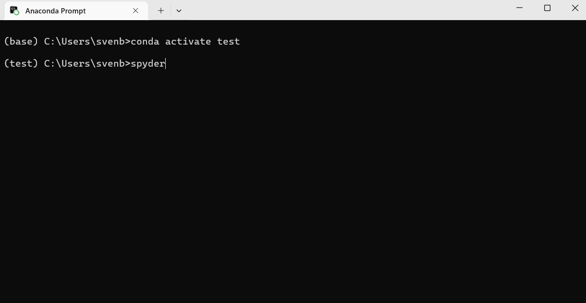

# E604

## Anaconda

Anaconda ist eine Open-Source-Distribution für Python und R, die speziell für Data Science, Machine Learning und wissenschaftliches Rechnen entwickelt wurde. Sie enthält viele vorinstallierte Pakete und den Paketmanager `conda`.

### Spyder

Spyder ist eine wissenschaftliche Python-Entwicklungsumgebung (IDE), die mit Anaconda geliefert wird. Sie bietet einen Code-Editor, eine interaktive Konsole und einen Variablen-Explorer.

**Spyder starten:**

Um Spyder in einer bestimmten Conda-Umgebung zu starten, aktiviert man zunächst die gewünschte Umgebung und ruft dann `spyder` auf:

